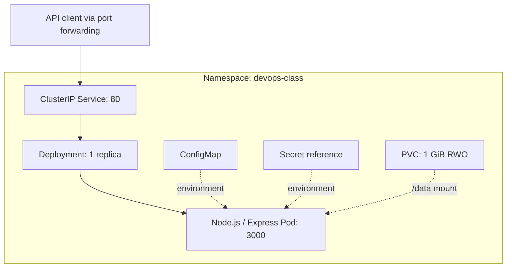

# Student API — Containerized REST API on Kubernetes

A hands-on cloud-native engineering project demonstrating Node.js REST API development, Docker containerization and declarative Kubernetes deployment.

## Technology stack

Node.js 22, Express 5, Docker, Kubernetes, YAML and npm.

## Architecture



## Features

- JSON REST endpoints and health endpoint.
- Docker image based on Node.js 22 Alpine.
- Kubernetes Deployment and ClusterIP Service.
- Startup, readiness and liveness probes.
- CPU and memory requests and limits.
- ConfigMap and Secret environment references.
- PersistentVolumeClaim and separate ephemeral/persistent storage demonstrations.

## API endpoints

| Method | Path | Purpose |
|---|---|---|
| GET | `/` | Application metadata and environment |
| GET | `/health` | Health status and process uptime |
| POST | `/hello` | Greeting; accepts JSON with optional `name` |

## Run locally

Prerequisites: Node.js 22 and npm.

```bash
npm ci
npm start
```

In a second terminal:

```bash
curl http://localhost:3000/
curl http://localhost:3000/health
curl -X POST http://localhost:3000/hello -H 'Content-Type: application/json' -d '{"name":"Dennis"}'
```

## Run with Docker

```bash
docker build -t student-api:4.1 .
docker run --rm -p 3000:3000 student-api:4.1
```

Stop the local Node.js server first if it is using port 3000.

## Deploy to local Kubernetes (Minikube)

Prerequisites: Docker, kubectl, Minikube and a working dynamic storage provisioner.

```bash
minikube start
minikube image build -t student-api:4.1 .
kubectl create namespace devops-class --dry-run=client -o yaml | kubectl apply -f -
kubectl create secret generic student-api-secret -n devops-class --from-literal=API_KEY=local-demo-only --dry-run=client -o yaml | kubectl apply -f -
kubectl apply -f k8s/student-api-configmap.yaml
kubectl apply -f k8s/student-data-pvc.yaml
kubectl apply -f k8s/student-api-deployment.yaml
kubectl apply -f k8s/student-api-service.yaml
kubectl rollout status deployment/student-api -n devops-class --timeout=120s
kubectl get pods,svc,pvc -n devops-class
kubectl port-forward -n devops-class svc/student-api-service 8080:80
```

In a second terminal:

```bash
curl http://localhost:8080/health
```

The Secret value above is a disposable lab placeholder, not a production credential. Apply only the listed manifests for the main application; other manifests are separate demonstrations.

## Current scope and limitations

This is a learning project, not a production student records system. The application does not currently persist records to the mounted volume or enforce API-key authentication. APP_MESSAGE and DATA_DIR are configured but not consumed by the application. The deployment uses one replica. Automated tests and CI are planned improvements.

## Author

Dennis Samuel Akpan — [GitHub](https://github.com/udohette)
